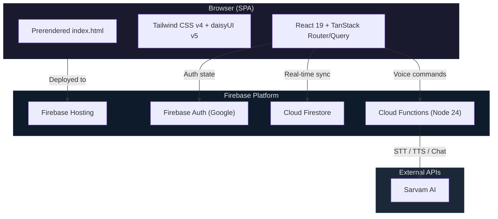
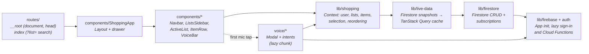
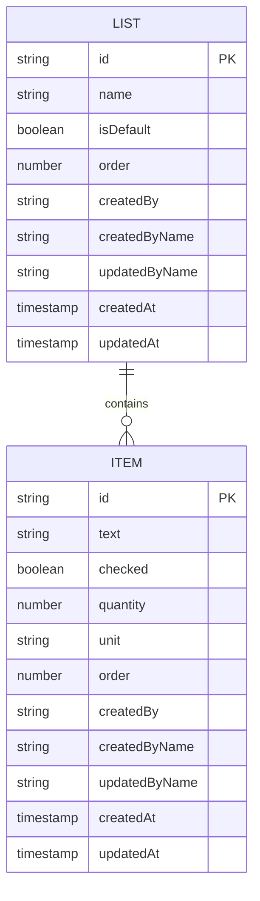
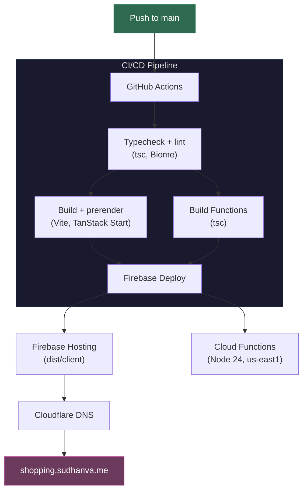
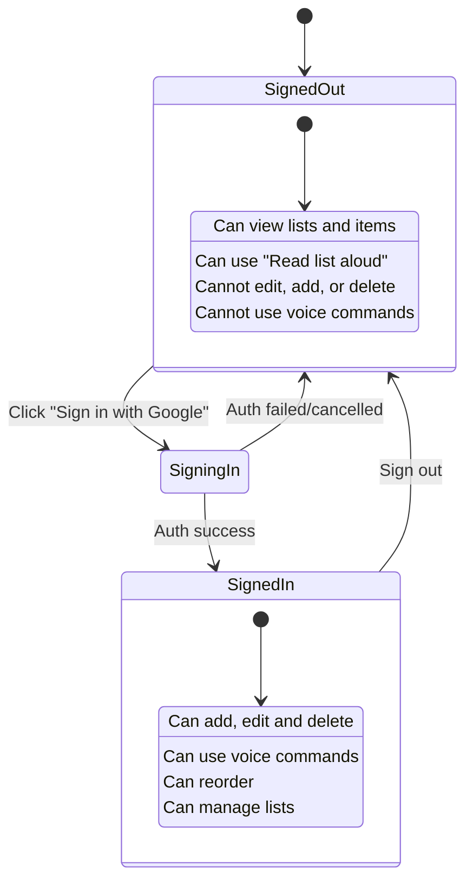

# Shopping

Shared shopping lists with voice commands. The app uses React, TanStack Start, Firebase and daisyUI.

## Features

- Shared lists. All users can read the lists. Users who sign in with Google can change them.
- Add, edit, check, uncheck and delete items.
- Set a quantity for each item (decimal, default 1) with the − and + buttons.
- Set an optional unit for each item, for example kg or lb.
- Check all items, uncheck all items, clear the checked items or clear all items in a list.
- Rename a list from the header or from the sidebar.
- Delete a list. You can delete its items or move them to Inbox.
- Move lists and items up and down.
- See who created and who last edited each list and item.
- Give voice commands to add, check, uncheck and delete items, and to change lists.
- Hear the replies, and hear the full list read aloud.
- Use the dark theme (default) or the light theme.
- On a phone, open the lists with the menu button.
- The app shows the last list that you selected, also after you close the tab.
- Each list has a link (`/?list=<id>`). Back and Forward move between lists.

## Architecture

### Overview



### Frontend modules



### Data model



### Voice command flow

```mermaid
flowchart LR
    Mic["Tap mic"] --> Modal["Voice modal<br/>(records)"]
    Modal --> Send["Pause or<br/>tap Send"]
    Send --> B64["Base64 encode<br/>audio blob"]
    B64 --> CF["Cloud Function<br/><b>parseVoiceCommand</b>"]

    subgraph CloudFunction["Cloud Function (us-east1)"]
        CF --> STT["Sarvam STT<br/>(saaras:v4)"]
        STT --> Transcript["Transcript text"]
        Transcript --> Chat["Sarvam Chat<br/>(sarvam-105b)"]
        Chat --> Intent["JSON Intent"]
    end

    Intent --> Execute["Execute intent<br/>(add/edit/delete/...)"]
    Execute --> TTS["Cloud Function<br/><b>speakText</b>"]
    TTS --> SarvamTTS["Sarvam TTS<br/>(bulbul:v3)"]
    SarvamTTS --> Audio["Play audio"]

    style Mic fill:#2d6a4f,stroke:#40916c,color:#fff
    style Modal fill:#2d6a4f,stroke:#40916c,color:#fff
    style CloudFunction fill:#1b2838,stroke:#2a4858,color:#e0e0e0
```



### Voice intents

```mermaid
mindmap
    root((Voice Intents))
        Items
            add_item
            add_items_bulk
            edit_item_text
            set_quantity
            set_unit
            check_item
            uncheck_item
            delete_item
            move_item
        Bulk Operations
            check_all
            uncheck_all
            clear_checked
            clear_all
        Lists
            create_list
            select_list
            rename_list
            delete_list
            move_list
        Other
            read_items
            clarify
            unknown
```

### Deployment



### Sign-in and access



## Tech

- React 19 with React Compiler. Vite builds the app.
- TanStack Start prerenders `/` to static HTML.
- TanStack Router keeps the selected list in a typed `?list=` search parameter.
- TanStack Query holds the live Firestore data.
- Tailwind CSS v4 and daisyUI v5 for styles.
- Firebase Hosting, Firestore (Native mode) and Firebase Auth (Google).
- Sarvam AI for speech to text, intent parsing and text to speech.

## Setup

```bash
bun install
bun run dev        # http://localhost:3000
```

The production build prerenders `/` into `dist/client`. Firebase Hosting serves this folder.

```bash
bun run build
bun run serve      # serves dist/client
```

### Checks

```bash
bun install --cwd functions
bun run check   # tsc (app and functions) and Biome
```

### Lighthouse

```bash
bun run lighthouse https://shopping.sudhanva.me/
bun run lighthouse https://shopping.sudhanva.me/ --preset=desktop
```

## Firebase

```bash
bunx firebase-tools login
bunx firebase-tools use sudhanva-personal
bunx firebase-tools deploy
```

In the Firebase Auth console, enable the Google provider. Add your domains to the authorized domains.

### Cloud Functions (voice)

The voice functions run in `us-east1`. They use Sarvam for speech to text, intent parsing and text to speech. Set the API key:

```bash
firebase functions:secrets:set SARVAM_API_KEY
```

Deploy the functions:

```bash
bunx firebase-tools deploy --only functions
```

The functions accept calls only from signed-in users. They also reject browser calls from origins that are not in `VOICE_ALLOWED_ORIGINS`. If you do not set this variable, the functions use the default list in `functions/src/index.ts`.

### Voice commands

1. Tap the mic. "Listening…" shows when the microphone records, so the app does not lose your first words.
2. Say the command. A level meter shows that the microphone hears you.
3. Stop speaking. After a pause of about 2 seconds, the app sends the command. You can also tap Send.
4. The app converts the speech to text, finds the intent, does the action and speaks the result.
5. If the command is not clear, the app asks a question. Then it listens for the answer immediately.

Audio details:

- The browser records mono audio with echo cancellation, noise suppression and automatic gain. Chrome and Firefox record Opus. Safari records AAC.
- The app releases the microphone when the recording stops.
- If you do not speak for 8 seconds, the recording stops. The app does not send silent audio to the server.
- Users who are not signed in can only use "Read list aloud".

## Firestore rules

The rules are in `firestore.rules`. All users can read the lists. A write needs a signed-in user and must match the schema. Any Google account can sign in, so any signed-in user can change or delete all lists.

## Cloudflare DNS (optional)

- Add a CNAME record from `shopping.sudhanva.me` to `sudhanva-shopping-app.web.app`.
- Add the TXT record for domain verification.

## GitHub Actions deploy

When you push to `main`, the workflow checks the code, builds the app and deploys Firebase Hosting and Cloud Functions.

Required secret: `FIREBASE_SERVICE_ACCOUNT_SUDHANVA_PERSONAL`
