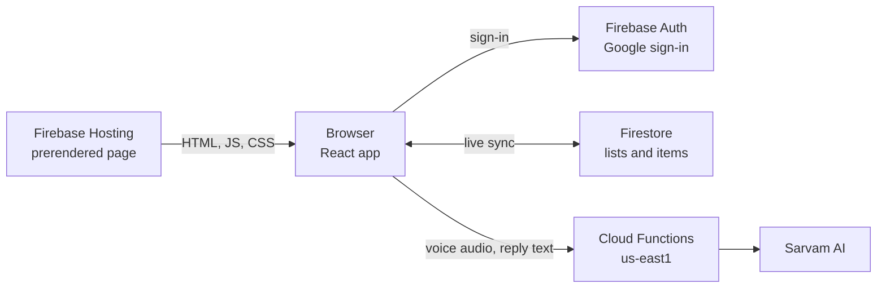
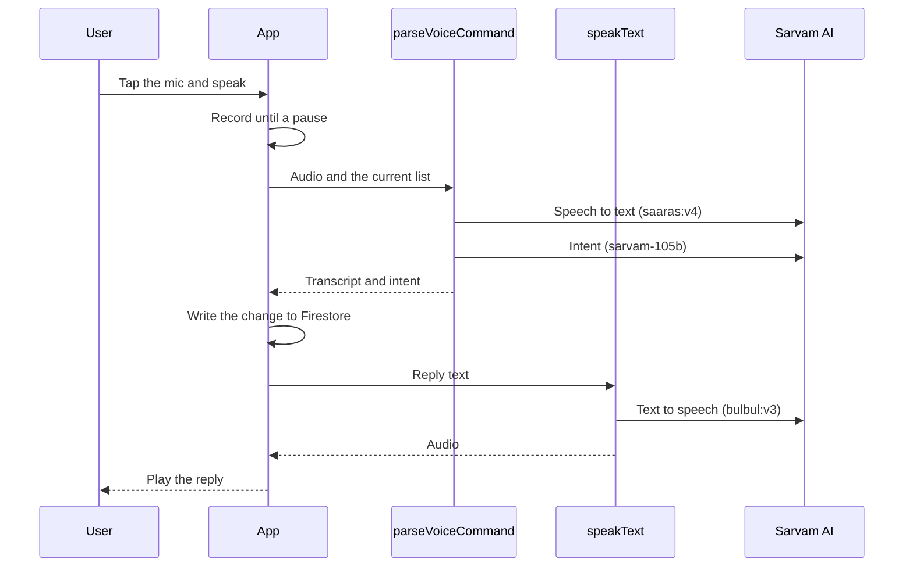
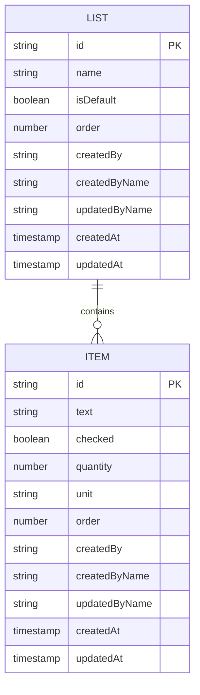

# Shopping

A shared shopping list with voice commands. It runs at https://shopping.sudhanva.me.

## Features

- Anyone can read the lists. You must sign in with Google to change them.
- Each item has a name, a quantity (default 1, decimals allowed) and an optional unit.
- You can check, uncheck, edit, delete and reorder items.
- You can create, rename, reorder and delete lists. When you delete a list, you can move its items to Inbox.
- Each list has its own link (`/?list=<id>`).
- Voice commands add, check, uncheck, edit and delete items, and change lists. The app speaks the result.
- "Read list aloud" reads the current list. It works without sign-in.
- The app has a dark theme and a light theme.

## Stack

- React 19 with React Compiler, built with Vite
- TanStack Start (prerender), TanStack Router (`?list=` parameter), TanStack Query (cache for live data)
- Tailwind CSS 4 and daisyUI 5
- Firebase Hosting, Firebase Auth, Firestore and Cloud Functions (Node.js 24)
- Sarvam AI for speech to text, intent parsing and text to speech
- Bun, TypeScript 7 and Biome

## How it works



- The build prerenders the page to static HTML. The browser shows the page before the JavaScript loads.
- The app reads lists and items with Firestore listeners. Each open browser gets changes immediately.
- The voice code and the Cloud Functions SDK load only when a user uses voice.

### Voice commands



- The app sends the command after a pause of about 2 seconds. You can also tap Send.
- If you do not speak for 8 seconds, the recording stops. The app does not send silent audio.
- The microphone stops when the recording stops.
- If the command is not clear, the app asks which item you mean. Then it listens for the answer.
- The server changes or deletes an item only if the transcript names that item.
- To cancel a command, close the dialog. This also works while the app processes the command.

### Data model



Items are in the subcollection `lists/{listId}/items`.

## Project layout

| Path | Content |
| --- | --- |
| `src/routes/` | The page and its `?list=` parameter |
| `src/components/` | UI components |
| `src/lib/` | Firebase setup, Firestore access and shared state |
| `src/voice/` | Recorder, voice dialog, voice actions and speech |
| `functions/src/index.ts` | Cloud Functions `parseVoiceCommand` and `speakText` |
| `firestore.rules` | Firestore security rules |
| `public/` | Static files |

## Develop

Install the dependencies and start the dev server on http://localhost:3000:

```bash
bun install
bun install --cwd functions
bun run dev
```

Run the type checks and the linter:

```bash
bun run check
```

Build the site into `dist/client` and serve the build:

```bash
bun run build
bun run serve
```

Run Lighthouse:

```bash
bun run lighthouse https://shopping.sudhanva.me/
bun run lighthouse https://shopping.sudhanva.me/ --preset=desktop
```

## Deploy

A push to `main` starts the GitHub Actions workflow. The workflow runs the checks, builds the site and deploys Firebase Hosting and Cloud Functions. It needs the repository secret `FIREBASE_SERVICE_ACCOUNT_SUDHANVA_PERSONAL`.

To deploy from your computer:

```bash
bunx firebase-tools login
bunx firebase-tools use sudhanva-personal
bun run build
bun run deploy
```

To deploy only the Firestore rules, run `bun run deploy:firestore`.

### First-time setup

1. In the Firebase console, enable the Google sign-in provider. Add your domains to the authorized domains.
2. Set the Sarvam API key:

   ```bash
   bunx firebase-tools functions:secrets:set SARVAM_API_KEY
   ```

3. Optional: set `VOICE_ALLOWED_ORIGINS` (a comma-separated list) in `functions/.env.<project id>`. If you do not set it, the functions use the list in `functions/src/index.ts`.
4. In DNS, add a CNAME record from `shopping.sudhanva.me` to `sudhanva-shopping-app.web.app`. Add the TXT record that Firebase gives for verification.
